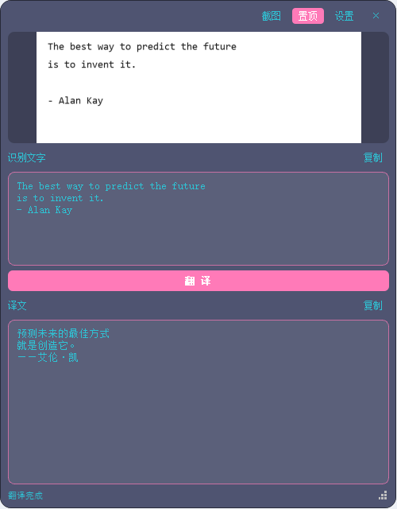

# 赵相机 · 截图 + 剪贴板 + OCR + 本地翻译

一款 Windows 悬浮窗小工具：**按 `Win + Shift + S` 框选截图后，自动弹出悬浮窗并识别文字，点一下「翻译」即可本地翻译**，识别结果和译文都能编辑、一键复制。

全程本地运行，断网也能用。



---

## 下载安装

到 [Releases](../../releases) 页面下载最新的 `赵相机_v1.0_安装包.exe`，双击安装即可。

- **不需要管理员权限**，装到当前用户目录
- 自动创建桌面和开始菜单快捷方式
- 安装包已内置离线翻译模型（约 298MB），对方断网也能翻译

---

## 功能

- 🔗 **联动系统截图**：监听剪贴板，`Win+Shift+S` 框选后自动弹出悬浮窗（也支持复制任意图片触发）
- 📷 **内置截图**：悬浮窗「截图」按钮 / 托盘「截图」可框选截图（兜底）
- 🔍 **深度学习 OCR**：默认 **RapidOCR**（PaddleOCR ONNX 版，中文识别准、空格/缩进好、CPU 运行）；设置里可切回轻量的 Windows 自带 OCR
- 🌐 **本地翻译**：调用 **LM Studio + hy-mt2-1.8b**（中英互译，自动检测方向）
- ✏️ **文字可编辑**：识别结果和译文都能手动改，改完再翻译/复制
- 📋 **一键复制**：识别文字、译文各带「复制」按钮
- 📌 **置顶**：类似 DeskPins，悬浮窗始终在最前（可开关）
- 🪟 **透明背景 / 不透明文字**：背景透明度可调（越大越透明），文字始终清晰
- 🎨 **配色与字体分开调**：配色（蓝粉 / iPhone 透明玻璃 / 浅色 / 自定义背景图）+ **字体颜色和字号独立可调**
- ☁️ **三种翻译方式**：本地 LM Studio（优先）→ 云端 API → **内置离线模型**，没网、没本地 AI 也能翻译
- 🧭 **首次运行引导**：第一次打开会自动引导选择翻译方式，不用看文档
- 🔔 **复制反馈**：点「复制」后按钮变「复制成功」提示 2 秒
- 🖼️ **双击图片预览**：用 **Windows 截图工具**打开这张图，可直接裁剪/标注/保存（右键可选内置查看器）
- 🚀 **开机自启**：设置里一键开启（写当前用户注册表，无需管理员）
- ⚙️ **本地 Agent API 接入**：LM Studio 地址 / Token / 模型 / 翻译方向 / OCR 引擎均可在设置里改

## 技术栈

| 模块 | 方案 |
| --- | --- |
| GUI | Python 3.13 + PyQt5（无边框透明悬浮窗） |
| OCR | **RapidOCR（深度学习，默认）** + Windows 内置 OCR（可切换） |
| 翻译 | LM Studio OpenAI 兼容接口 `hy-mt2-1.8b` |
| 截图 | 剪贴板监听 + 内置框选截图 |

## 前置条件

1. **LM Studio** 已安装且已下载模型 `hy-mt2-1.8b`（本机已就绪）。
2. LM Studio 服务端口 `1234` 可访问；App 会在翻译时自动启动服务、自动加载模型。
3. API Token 已配置（`config.json` 的 `api_token`）。
4. RapidOCR 模型已随程序打包/安装，**无需联网下载**。

## 运行方式

**方式一：一键运行（推荐）**
双击 `run.bat`，托盘出现「赵相机」图标并弹出悬浮窗。

> 运行环境为 `D:\zhaocamera_build\.buildenv`（**纯英文路径**，因 pip 版 Qt 在中文路径下解析不到插件）。请勿删除该目录。

**方式二：命令行**
```powershell
D:\zhaocamera_build\.buildenv\Scripts\pythonw.exe main.py
```

**方式三：打包后的 exe**
运行 `build_exe.bat`，产物在 `dist\ZhaoCamera.exe`（双击即用，可改名）。

## 使用说明

1. 按 `Win + Shift + S` 框选要识别的区域（图片自动进剪贴板）。
2. 悬浮窗自动弹出，顶部显示截图，中间自动显示识别文字（可手动编辑纠错）。
3. 点「**翻 译**」→ 下方显示译文（首次会加载模型，稍等几秒）。
4. 点「复制」复制识别文字 / 译文；拖动中间分割条可调整两个文本框大小。
5. 双击图片预览 → 用 **Windows 截图工具**打开这张图（可裁剪、标注、保存）；右键图片框可选「内置查看器看大图」。
   > 交给截图工具前会把截图存到 `图片\ZhaoCamera\snip_日期_时间.png`，在截图工具里改完直接保存即可。
6. 托盘右键：显示窗口 / 截图 / 设置 / 退出。

## 设置项

| 设置 | 说明 |
| --- | --- |
| 置顶 | 悬浮窗是否始终在最前 |
| 开机自启 | 登录后自动启动（写 `HKCU\...\Run`） |
| 背景透明度 | 0–100，**越大越透明**，只影响背景，文字始终不透明 |
| 配色 | 蓝粉（默认）/ iPhone 透明玻璃 / 浅色 / 自定义图片 |
| 字体颜色 | 自定义文字颜色（默认用主题配色），带取色器 |
| 字体大小 | 9–40 px |
| OCR 引擎 | RapidOCR（深度学习，推荐）/ Windows 自带 OCR（轻量） |
| 自定义背景 | 选择本地图片作为悬浮窗背景（需配色选「自定义图片」） |
| 翻译后端 | 自动（本地 → 云端 → 离线）/ 只用本地 LM Studio / 只用云端 API / 只用内置离线模型 |
| 离线模型 | 显示是否已安装；把 `offline_models` 文件夹放到程序目录即可启用 |
| 本地 · LM Studio 地址 | 默认 `http://127.0.0.1:1234/v1` |
| 本地 · API Token | LM Studio 鉴权 Token（明文存于 `config.json`，请勿外传） |
| 本地 · 模型 | 默认 `hy-mt2-1.8b` |
| 云端 · API 地址 | 如 `https://api.deepseek.com/v1` |
| 云端 · API Key | 没有本地 AI 时用它翻译 |
| 云端 · 模型 | 如 `deepseek-chat` |
| 翻译方向 | 自动检测 / 中→英 / 英→中 |

## 打包 exe

```bat
build_exe.bat
```
- 在 `D:\zhaocamera_build`（纯英文路径）用干净 venv 打包，含 RapidOCR 模型，单文件 `dist\ZhaoCamera.exe`（约 143MB）。
- `config.json` 写到 exe 同目录（请把 exe 放在可写目录）。

## 给别人的电脑用（对方没有本地 AI）

**截图 + 识别文字 + 复制** 完全离线、开箱即用，不需要装任何东西（RapidOCR 模型已打进 exe）。

**翻译**有三级优先级，「自动」模式会按 **本地 → 云端 → 离线** 的顺序自动挑一个能用的（某个不可用不会报错，会继续往后试）：

| 后端 | 需要什么 | 说明 |
| --- | --- | --- |
| 本地 LM Studio | 装 LM Studio + `hy-mt2-1.8b` | 质量最好，优先使用 |
| 云端 API | 一个 API Key | 质量好，需要联网 |
| 内置离线模型 | 什么都不用（带 `offline_models` 文件夹） | **完全离线**，质量一般 |

### 分发给别人

**推荐：直接发安装包**（单个 exe 文件）

对方双击 → 一路「下一步」→ 自动装好并创建桌面 + 开始菜单快捷方式，**不需要管理员权限**（装到用户目录）。
安装包内含离线翻译模型，对方**断网也能翻译**；卸载走「开始菜单 → 卸载 赵相机」。

- 安装包：`D:\zhaocamera_release\赵相机_v1.0_安装包.exe`
- 打包脚本：`D:\zhaocamera_release\赵相机安装包.iss`（用 Inno Setup 6 的 `ISCC.exe` 重新编译）
- 纯净配置：`D:\zhaocamera_release\赵相机\config.json`（**不含任何个人凭据**；`first_run_done=false` 让对方第一次打开时看到引导页）

**备用：绿色包**（不想用安装程序时，把下面几样一起发过去，解压后双击 `ZhaoCamera.exe`）

```
赵相机\
├── ZhaoCamera.exe        主程序
├── config.json           配置（发之前请把自己的 Token / Key 清空）
└── offline_models\       内置离线翻译模型（约 162MB；不想给离线翻译可不带）
    ├── zh2en\
    └── en2zh\
```

- **带 `offline_models`**：对方完全断网也能翻译。
- **不带**：对方可以填云端 API Key，或自己装 LM Studio。
- 对方第一次运行时会弹出**引导页**，显示检测结果（本地 AI / 离线模型是否就绪），按提示选一下即可。

### 云端 API 例子（DeepSeek）

- API 地址：`https://api.deepseek.com/v1`
- 模型：`deepseek-chat`
- API Key：对方自己的 Key

> Key 会以明文存在对方电脑的 `config.json` 里，提醒对方别外传；分发前记得清空你自己的凭据。

## 常见问题

| 现象 | 处理 |
| --- | --- |
| 翻译报「服务无法连接 127.0.0.1:1234」 | 手动打开 LM Studio，确认 Server 端口为 1234 |
| 翻译报 401 | LM Studio「Developer → Server Settings → Manage Tokens」生成 Token 填入设置 |
| 翻译报「模型加载失败」 | 确认已下载 `hy-mt2-1.8b` |
| OCR 识别慢/不准 | 设置里确认 OCR 引擎为 RapidOCR；首次识别需初始化模型（约 1 秒） |
| 悬浮窗文字看不清 | 调高「背景透明度」或换配色；文字已用 #2FC2D4 提高可见度 |
| 离线翻译质量一般 | 内置的是小模型（Opus-MT，约 162MB），长句/常规文本够用；追求质量请用本地 LM Studio 或云端 API |
| 想知道哪一环不可用 | 运行 `ZhaoCamera.exe --selftest`，会生成 `selftest_report.txt`，列出 OCR / 离线翻译 / 本地 AI / 系统联动 的实际状态 |
| 运行报 Qt 插件找不到 | 用 `run.bat`（走 ASCII 路径环境）运行，别直接用中文路径下的 python |
| 内存紧张 | 翻译模型 1.13GB + RapidOCR 约 400MB，不加载 8B 视觉模型 |

## 目录结构

```
赵相机\
├── main.py               入口：托盘 + 剪贴板监听 + 截图调度
├── floating_window.py    悬浮窗
├── settings_window.py    设置窗口
├── capture.py            内置截图 + 图像转换
├── ocr.py / ocr_ps.ps1   RapidOCR + Windows OCR
├── translator.py         LM Studio 翻译
├── autostart.py          开机自启
├── themes.py             配色主题
├── config.py / config.json  配置读写
├── workers.py            后台线程
├── run.bat               一键运行（用 ASCII 路径环境）
├── build_exe.bat         打包 exe
├── requirements.txt      依赖清单
└── README.md             本文件
```

## 说明

- API Token 以明文保存在 `config.json`，**请勿分享该文件，也不要提交到 git**（本仓库的 `.gitignore` 已排除它）。
- 内置截图使用系统当前分辨率，多显示器/缩放异常时可只用 `Win+Shift+S`。

---

## 许可

[MIT License](LICENSE) —— 随便用、随便改、可以商用，保留版权声明即可。

---

## 关于图标

程序图标里的角色是《崩坏：星穹铁道》的 **三月七**，角色版权归 **miHoYo / 米哈游** 所有。

本项目的图标仅作为**同人作品**使用，遵循米哈游的同人创作规范；本项目与米哈游无任何关联，也未获得其背书。
若你是版权方并希望移除该素材，请联系我，会立即更换。

---

## 致谢

- [RapidOCR](https://github.com/RapidAI/RapidOCR) —— 深度学习 OCR
- [Argos Translate](https://github.com/argosopentech/argos-translate) —— 离线翻译模型
- [LM Studio](https://lmstudio.ai/) —— 本地大模型运行时
- 本项目全程本地离线运行（除 LM Studio 本机服务外不联网）。
